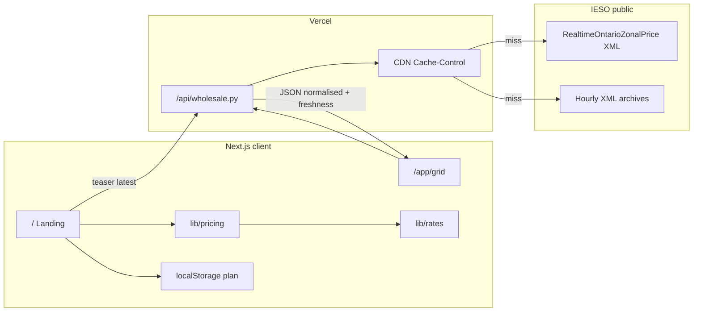

# PowerSave v1 — Product Requirements Document

**Status:** Session 3 complete; Session 4 not started  
**Design source of truth:** [`PowerSave-Design/project/`](../PowerSave-Design/project/) (READ-ONLY)  
**Effective rates:** OEB RPP, Nov 1 2026

---

## 1. Product

PowerSave is a free, guest-only web app that tells Ontario households the cheapest time to run chores (laundry, dishwasher, EV) based on their **rate plan**, plus a clearly labelled live **wholesale-market** view on The Grid.

### Non-negotiable rules

1. Advice comes from the household’s **rate plan**, never from the wholesale price.
2. Wherever a wholesale price is shown, the label **“Wholesale market price. Not what you pay.”** must be visible next to it.
3. Savings are estimates of **electricity cost only**. Say so.
4. For TOU weekends/holidays and Tiered plans: **“Any time. Same price all day.”**
5. Guests are first-class. No login wall.
6. No fake proof, testimonials, or real-organisation logos.
7. Sample numbers carry a **“Sample data”** tag.
8. Never rely on colour alone (hatch patterns, labels, outlines).
9. Lime `#DDF247` only on the saving figure and the single primary CTA (window block may use lime outline **plus** ink outline per Handoff).
10. Use **Muted strong** on panel backgrounds, not plain muted grey.

---

## 2. Scope

### IN (v1)

| Route | Source design | Notes |
|-------|---------------|--------|
| `/` | `Landing.dc.html` (+ `-dk`, `-m`, `-dk-m`) | Full functionality |
| `/app/grid` | `Grid.dc.html` (+ variants) | Full functionality, live data |
| Shared | `Main.dc.html`, `Ribbon.dc.html`, `Handoff.dc.html` | Tokens, C01–C19 as needed, Ribbon once |

Landing must include: plan selector → chore cards, live price ribbon, scroll-moment sticky card (laundry 5:30→7:00 PM, live cost), saving-figure ticker, how-it-works steps, plans panel, Grid teaser, method card, footer.

Grid must include: always-visible wholesale label, live price card, countdown, live/delayed/stale from data freshness, 5-min chart with 3-day & 7-day **hour-of-day average** lines + toggle, hover/slider scrub, explainer, forecast-accuracy panel.

### OUT (Coming soon stubs — keep site nav, no 404s)

`/start`, `/app` (Today), `/app/chore/[id]`, `/app/tomorrow`, `/app/settings`, `/app/signin`, `/dev/*`, accounts, databases.

Also stub design-linked pages that are not Landing/Grid builds: `/how-it-works`, `/plan`, `/privacy` (full `.dc.html` exists but is out of v1 build scope per brief).

### Explicit non-goals

Paid APIs, auth, DB, scraping behind login, inventing “live” numbers, extra pages/features not listed.

---

## 3. Tech stack

| Layer | Choice |
|-------|--------|
| Frontend | Next.js App Router, TypeScript strict, Tailwind CSS |
| Fonts | Geist + Geist Mono via `geist` or `next/font` only |
| Deploy | Vercel free tier |
| Backend | Python Vercel serverless under `/api` |
| Cache | `Cache-Control: s-maxage` + Next revalidate; avoid hammering IESO |
| Charts | Hand-written SVG (match design) |
| Tests | Vitest (25 golden checks), pytest (Python normalisation) |
| Persistence | `localStorage` for selected plan only (try/catch; page works without it) |

**Zero running cost** is a hard constraint: no paid services, no paid API keys, no database.

---

## 4. Rate data (single config)

One typed module (e.g. `lib/rates/2026-11-01.ts`) with source comment + effective date. Never scatter rates in components.

| Plan | Periods | ¢/kWh |
|------|---------|-------|
| TOU | Off / Mid / On | 9.1 / 14.6 / 18.9 |
| ULO | Ultra / Off (weekend) / Mid / On | 3.7 / 9.1 / 14.6 / 37.7 |
| Tiered | Tier 1 / Tier 2 | 11.2 / 13.2 |

### Schedules (minutes from midnight) — port from `Ribbon.dc.html` / `Checks.dc.html`

**TOU weekday:** off if `m < 420 \|\| m >= 1140`; mid if `660 ≤ m < 1020`; else on.  
**TOU weekend/holiday:** off all day (9.1).  
**ULO weekday:** ultra if `m >= 1380 \|\| m < 420`; on if `960 ≤ m < 1260`; else mid.  
**ULO weekend:** ultra overnight as above; else off (9.1).  
**Tiered:** flat display as off-peak band; verdict “Any time. Same price all day.”

### Pricing engine (exact algorithm from Checks)

- Price each minute of the chore run; energy per minute = `kWh / durationMin`.
- Test start times every **15 minutes** over the search window.
- Pick cheapest cost; **earliest** on ties.
- Round each cost to the nearest cent, then subtract for saving.
- Chores: Laundry 3 kWh / 90 min; Dishwasher 1.2 / 120; EV 28.8 / 240.
- Golden clock: **Wed Nov 18 2026, 5:30 PM** (`nowMin = 1050`).

25 Vitest cases = the 24 field checks in `Checks.dc.html` + Tiered verdict row.

---

## 5. Wholesale data finding (Session 1 research)

### Verdict: usable free public feed exists — recommend proceed

Ontario’s market renewed **May 1 2025** (HOEP → Ontario zonal / OEMP). Live 5-minute Ontario zonal prices are public XML on the IESO Reports Site. **No API key. No fee.** Verified by fetching live XML on 2026-10-17.

### Primary feed — current 5-minute price

| Field | Detail |
|-------|--------|
| **Name** | Real-time 5-min Ontario Zonal Energy Price Report |
| **Directory** | https://reports-public.ieso.ca/public/RealtimeOntarioZonalPrice/ |
| **Latest file** | `PUB_RealtimeOntarioZonalPrice.xml` |
| **Hourly archives** | `PUB_RealtimeOntarioZonalPrice_YYYYMMDDHH.xml` (+ `_vN` versions) |
| **Format** | XML (`DocConfClass: PUB`). Price field `LmpCap` in **$/MWh**. Convert: `¢/kWh equivalent = $/MWh ÷ 10` (design: $46/MWh → 4.6¢). |
| **Update frequency** | After each successful RT calculation engine run (~every **5 minutes**). File holds up to 12 intervals for the current delivery hour; later intervals empty until filled. |
| **Retention** | Public reports retained ~**90 days** on the site. |
| **Help / schema** | Listed on [IESO Data Directory](https://www.ieso.ca/en/Power-Data/Data-Directory); XSD/stylesheet linked from the XML header. |

**Sample (live pull):** DeliveryDate `2026-10-17`, DeliveryHour `20`, Interval 1 `LmpCap` 52.48 → **5.248 ¢/kWh equivalent**.

### Supporting feeds

| Purpose | Feed | URL pattern |
|---------|------|-------------|
| Day-ahead hourly Ontario zonal (next day) | `DAHourlyOntarioZonalPrice` | https://reports-public.ieso.ca/public/DAHourlyOntarioZonalPrice/ `PUB_DAHourlyOntarioZonalPrice.xml` — `ZonalPrice` $/MWh, 24 hours |
| Pre-dispatch hourly (near-term) | `PredispHourlyOntarioZonalPrice` | https://reports-public.ieso.ca/public/PredispHourlyOntarioZonalPrice/ (available; optional for v1) |

### Chart “forecast” lines (design clarification)

Design legend (`Main` C08 / `Grid`): **“3-day average for this hour”** and **“7-day average for this hour”** — not IESO multi-day forward forecasts.  
**Plan:** compute hour-of-day averages from the last 3 and 7 days of `RealtimeOntarioZonalPrice` hourly archives. Tag as sample until enough history is in cache; if fetch fails, show delayed/stale/error UI — never invent live numbers.

### Licence / terms

- Host: https://reports-public.ieso.ca — public reports open to all ([IESO Outbound Automated Document](https://www.ieso.ca/-/media/Files/IESO/technical-interfaces/xml-automated-docs/IMO_SPEC_0100.pdf)).
- [IESO Terms of Use](https://www.ieso.ca/terms-of-use) (updated July 25, 2022): limited, non-exclusive licence to **use and reproduce** Content if every reproduction includes:  
  `Copyright © 2004-2022 Independent Electricity System Operator, all rights reserved. This information is subject to the Terms of Use set out in the IESO’s website (www.ieso.ca)`.
- **Do not** use IESO logos/marks; do not imply affiliation/endorsement (matches Landing footer copy).
- Acceptable-use: no overburdening the site → **cache aggressively** (suggested `s-maxage=60`–`120` for live; longer for historical day files).
- Data “as is”; UI must handle failure with design’s delayed (>5 min) / stale (>20 min) / error states.

### If this feed is rejected

Stop before Session 3 data code. Do not scrape private endpoints or invent live series.

---

## 6. Data flow



**Freshness states (Grid):**

| State | Condition (from design) |
|-------|-------------------------|
| live | Data age within expected ~5 min window; countdown runs |
| delayed | Update late; banner “Update delayed.” |
| stale | Age **> 20 minutes**; stronger banner |

On total failure: show error/stale UI; any fallback numbers must use **Sample data** tag.

---

## 7. Proposed file structure

```
PowerSave/
  docs/
    PRD.md
    PROGRESS.md
  PowerSave-Design/          # READ-ONLY design reference
    project/*.dc.html
  app/
    layout.tsx
    globals.css
    page.tsx                 # Landing /
    start/page.tsx           # stub
    how-it-works/page.tsx    # stub
    plan/page.tsx            # stub (not /plans)
    privacy/page.tsx         # stub
    app/
      page.tsx               # stub Today
      grid/page.tsx          # Session 3 (Coming soon stub in Session 2)
      tomorrow/page.tsx      # stub
      settings/page.tsx      # stub
      signin/page.tsx        # stub
      chore/[id]/page.tsx   # stub
  components/
    Ribbon.tsx
    SampleDataTag.tsx
    SiteNav.tsx
    SiteFooter.tsx
    ThemeToggle.tsx
    ComingSoon.tsx
    landing/…                # Landing sections as needed
  lib/
    rates/2026-11-01.ts
    pricing.ts
    format.ts
    plan-storage.ts
  api/
    wholesale.py             # Session 3
  __tests__/
    pricing.test.ts          # Vitest · 25 golden checks
  package.json
  tailwind.config.ts
  tsconfig.json
  vitest.config.ts
```

Stub URLs (exact): `/start`, `/app`, `/app/tomorrow`, `/app/settings`, `/app/signin`, `/app/chore/[id]`, `/how-it-works`, `/plan`, `/privacy`.

---

## 8. Component map (design C01–C19 → React)

| ID | Design name | v1 build | Used on |
|----|-------------|----------|---------|
| C01 | PricePeriodChip | Yes | Landing plans, Ribbon labels |
| C02 | PriceRibbon | Yes — shared `Ribbon` | Landing, chore cards |
| C03 | ChoreCard | Yes | Landing hero panel |
| C04 | DoneByPicker | Stub only if linked; **not on Landing/Grid** | Out of page scope |
| C05 | QuietHoursToggle | No (Today/Settings) | OUT |
| C06 | PlanSelectorCard | Partial — Landing uses compact plan `<select>`; full card if needed for parity | Landing |
| C07 | BillHelper | No (Start flow) | OUT → Coming soon |
| C08 | PriceLineChart | Yes | Grid (+ Landing teaser mini SVG) |
| C09 | Countdown + LastUpdated + StaleBanner | Yes | Grid |
| C10 | SampleDataTag + mono tags | Yes | Landing, Grid |
| C11 | DisclaimerLine | Yes | Landing |
| C12 | FeedbackButtons | No (Today) | OUT |
| C13 | Button | Yes | Landing, Grid, stubs |
| C14 | Field | Minimal (plan select, chart range) | Landing, Grid |
| C15 | Sidebar | Yes (Grid desktop) | Grid |
| C16 | TabBar | Yes (Grid mobile) | Grid |
| C17 | Toast | Only if a v1 interaction needs it | Optional |
| C18 | Skeleton | Optional loading | Grid |
| C19 | EmptyState | No | OUT |

Tokens / type / space / motion: from `Main.dc.html` + `Handoff.dc.html` Tailwind extend snippet.

Theme: CSS variables on `:root` / `.dark`; `prefers-color-scheme` + manual toggle. Breakpoints aligned to **390px** and **1440px** designs.

---

## 9. Session plan (reminder)

| Session | Deliverable |
|---------|-------------|
| **1 (this)** | Design read, IESO research, PRD + PROGRESS — **stop for proceed** |
| **2** | Scaffold, tokens, rates + pricing + Vitest, Ribbon, full Landing, stubs, local demo |
| **3** | Python API + pytest, full Grid + Landing teaser live number |
| **4** | A11y/responsive pass, rule checklist, Vercel deploy steps |

---

## 10. Open questions — RESOLVED (see PROGRESS.md Decisions)

All five answered APPROVED. Route correction: `/plan` not `/plans`. Forecast-accuracy panel stays ghost + Sample data. Freshness from XML `DeliveryDate`/`DeliveryHour` in Session 3.

---

## 11. Deviations already anticipated

| Topic | Note |
|-------|------|
| Design nesting | `PowerSave-Design/` lives inside the git repo (confirmed OK). |
| No screenshots | Proceed without `screenshots/`. |
| Lime on best-window | Design uses lime outline + ink outline; Handoff documents both brief and checklist. |
| Landing hero “live” ribbon | Until Session 3 API exists, Landing Grid teaser and any wholesale figure stay **Sample data**; rate-plan advice can still use real OEB math with sample-tagged demo clock (Wed Nov 18 2026 17:30) as in design. |
| C04–C07, C12, C19 | Not required for Landing/Grid surfaces; omit unless a stub page needs a button. |
